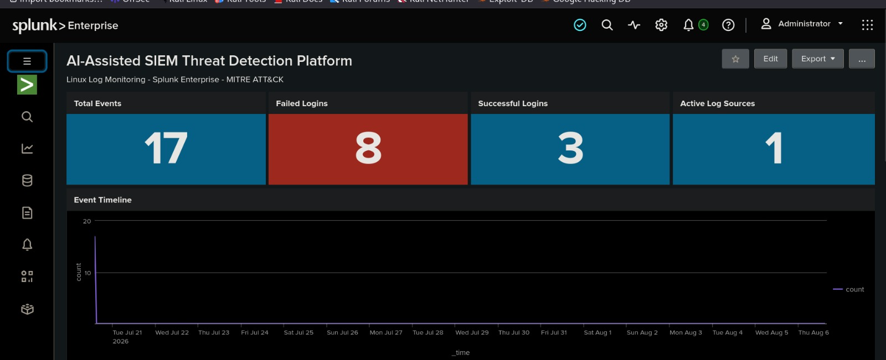
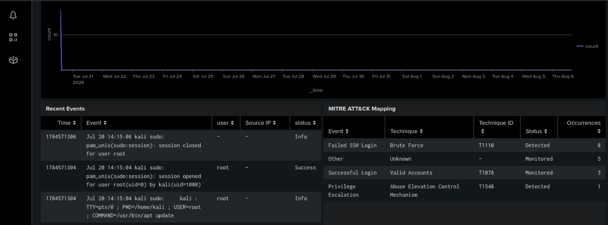
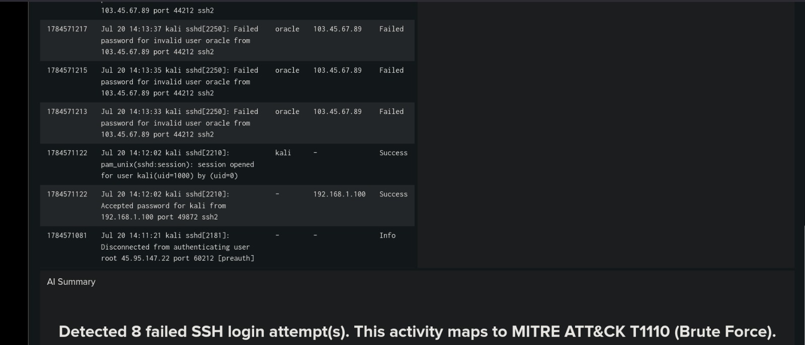
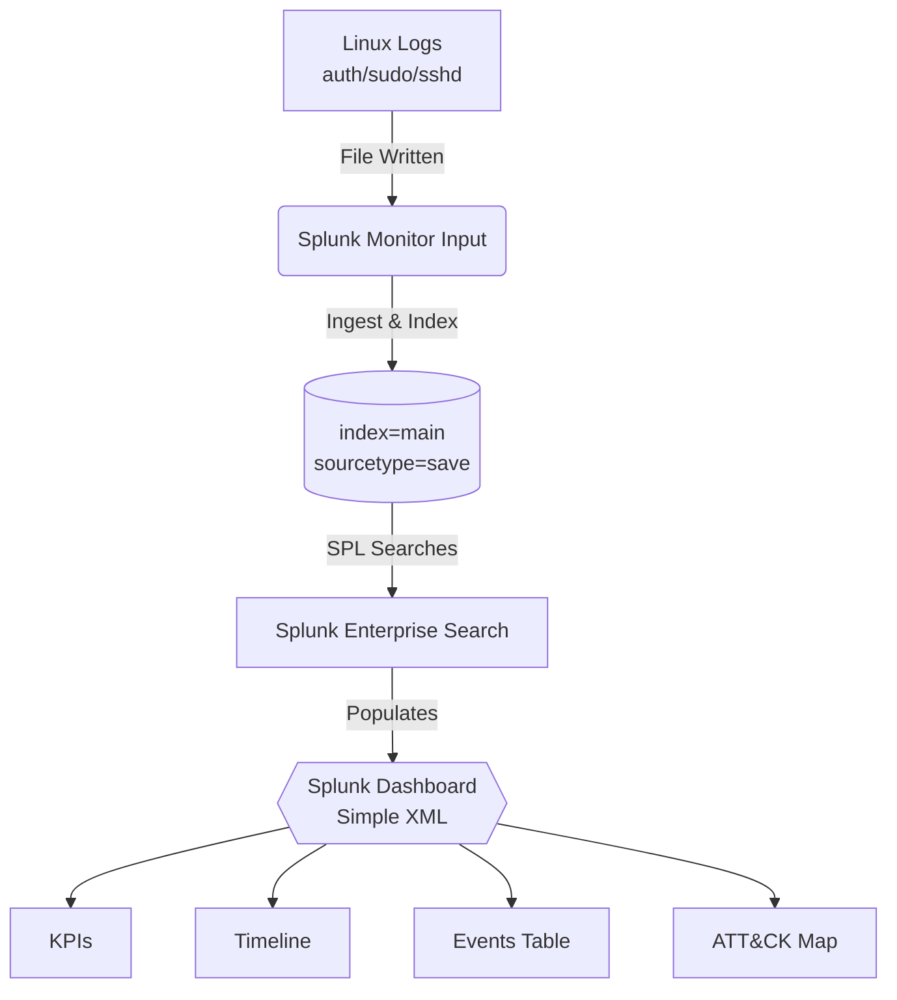

<p align="center">
  <a href="https://github.com/abhinav4961/splunk-soc">
    
  </a>
</p>

<p align="center">
  
  
  
  
</p>

<h3 align="center">A minimal, educational Security Information and Event Management (SIEM) dashboard designed to demonstrate how a SIEM collects logs, detects attacks, and maps detections to the MITRE ATT&CK framework.</h3>

---

> [!NOTE]
> **Built for Education:** Every panel on this dashboard answers one of three core questions: **What happened? Is it suspicious? Which MITRE ATT&CK technique does it map to?**

<br>

## Table of Contents

- [Platform Features](#platform-features)
- [Dashboard Panels](#dashboard-panels)
- [MITRE ATT&CK Mapping](#mitre-attck-mapping)
- [System Architecture](#system-architecture)
- [Deployment Guide](#deployment-guide)
- [Project Structure & Troubleshooting](#project-structure--troubleshooting)

<br>

## Platform Features



* **4 KPI Cards** — Real-time metrics showing current totals without misleading percentages.
* **Event Timeline** — Visual representation of when security events occurred.
* **Recent Events Table** — Live parsed Linux authentication, `sudo`, and SSH logs.
* **MITRE ATT&CK Mapping** — Automatically classifies real events into established attack techniques.
* **AI Summary** — Dynamic, human-readable text generated from actual indexed log counts.
* **Fully Data-Driven** — Zero hardcoded metrics; every panel queries live Splunk data dynamically.

<br>

## Dashboard Panels



| Section | Panel | Purpose |
|---------|-------|---------|
| **Overview** | Total Events | How much log data do we currently have? |
| **Overview** | Failed Logins | Count of authentication failures detected. |
| **Overview** | Successful Logins | Count of valid account activity. |
| **Overview** | Active Log Sources | How many distinct hosts are reporting logs? |
| **Timeline** | Event Timeline | Hourly line chart showing when events occurred. |
| **Recent Events** | Recent Events Table | Live view of parsed events. |
| **ATT&CK** | MITRE Mapping | Maps real events to MITRE techniques + IDs. |
| **Summary** | AI Summary | Auto-generated plain-text analysis. |

<br>

## MITRE ATT&CK Mapping



> [!TIP]
> The dashboard maps **real log patterns** to MITRE ATT&CK techniques dynamically using Splunk SPL — nothing is hardcoded!

| Log Pattern | Event | Technique | Technique ID | Status |
|-------------|-------|-----------|--------------|--------|
| `Failed password` (SSH) | Failed SSH Login | Brute Force | **T1110** | Detected |
| `Accepted password` / `session opened` | Successful Login | Valid Accounts | **T1078** | Monitored |
| `COMMAND=` (sudo) | Privilege Escalation | Abuse Elevation Control Mechanism | **T1548** | Detected |

<br>

## System Architecture



<br>

## Deployment Guide

<details>
<summary><b>1. Dashboard Installation</b> (Click to expand)</summary>
<br>

Copy the provided XML dashboard into Splunk's search app views folder:

```bash
sudo mkdir -p /opt/splunk/etc/apps/search/local/data/ui/views/
sudo cp siem_dashboard.xml /opt/splunk/etc/apps/search/local/data/ui/views/siem_dashboard.xml
sudo /opt/splunk/bin/splunk restart
```

Once restarted, open the dashboard in your browser: `http://localhost:8000/en-US/app/search/siem_dashboard`

</details>

<details>
<summary><b>2. Log Monitoring Setup</b> (Click to expand)</summary>
<br>

Run the setup script to configure a monitor input that will auto-index any log file you drop in:

```bash
sudo bash setup_monitor.sh
```

**Adding your own logs later:** Simply drop them in the folder! Splunk will index them within seconds.
```bash
sudo cp yourfile.log /var/log/splunk-monitor/
```
</details>

<details>
<summary><b>3. Generating Test Data</b> (Click to expand)</summary>
<br>

To see the dashboard light up, generate a realistic auth log with **today's date**. 

> [!WARNING]
> This is required because old dates fall outside the dashboard's visible timeframe!

```bash
bash generate_test_logs.sh
sudo cp test_auth_*.log /var/log/splunk-monitor/test_auth.log
```
</details>

<br>

## Project Structure & Troubleshooting

<details>
<summary><b>View Repository Structure</b> (Click to expand)</summary>
<br>

```text
├── siem_dashboard.xml        # Main Splunk dashboard (Simple XML)
├── setup_monitor.sh          # Configures Splunk monitor input for log folder
├── generate_test_logs.sh     # Creates fresh test logs with today's date
├── generate_mock_data.sh     # (Optional) HEC-based mock event generator
├── sample_auth.log           # Static sample auth/sudo/sshd logs
├── index.html                # (Optional) Static mock dashboard for Cloudflare Pages demo
└── README.md                 # Project Documentation
```
</details>

<details>
<summary><b>Common Issues & Fixes</b> (Click to expand)</summary>
<br>

| Problem | Fix |
|---------|-----|
| **Dashboard 404** | Ensure `siem_dashboard.xml` is in `/opt/splunk/etc/apps/search/local/data/ui/views/` and Splunk was restarted. XML must be valid (any unescaped `&` in "ATT&CK" breaks it — must be `ATT&amp;CK`). |
| **All Zeros / No Data** | Check the index: run `index=main | stats count by sourcetype` in Splunk Search. If your data is in another index, update every `index=main` in the XML. |
| **Timeline graph flat** | Your logs are too old! Test logs must be dated **today** — regenerate with `bash generate_test_logs.sh`. |
</details>

<br>

## Roadmap

- [ ] Live Log Ingestion
- [ ] Detection Rules & Alerts Panel
- [ ] Threat Intelligence Feed
- [ ] MITRE ATT&CK Heatmap
- [ ] MITRE-ATLAS Mapping
- [ ] Risk Score Calculation
- [ ] Geographic Attack Map
